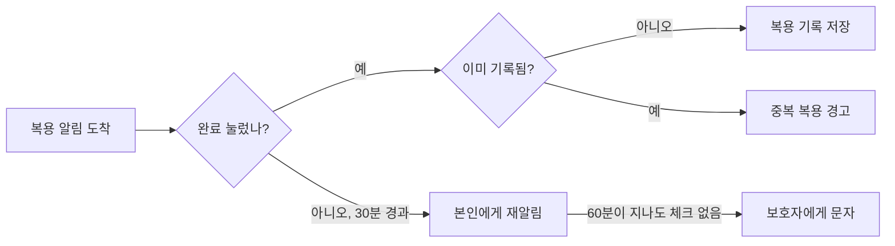

# 복약 관리 서비스 기획서

2026-11-12 · 원본 문서: https://claude.ai/artifact/1WrBkDQHb4scQX7JDoedU3

## 1. 서비스 개요

약을 제때 먹었는지 기록하고, 함께 먹어도 되는 조합인지 알려 주는 복약 관리 서비스다. 서비스 이름은 아직 정하지 않았다.

사용자에게 주는 가치는 세 가지다.

- **잊지 않는다.** 약마다 다른 복용 시간을 한곳에 등록하고 알림을 받는다.
- **두 번 먹지 않는다.** 복용 완료를 기록하고, 이미 먹은 약을 다시 기록하려 하면 경고한다.
- **섞어 먹어도 되는지 안다.** 등록한 약과 영양제 사이의 주의 조합을 직접 찾아보지 않아도 확인한다.

보호자는 복용 상태를 확인하고, 복용을 놓쳤을 때 문자를 받는다.

## 2. 문제 정의

여러 약을 먹는 사람은 시간, 복용 여부, 조합이라는 세 가지를 머릿속으로만 관리하고 있다.

| 문제 | 실제 상황 | 이 서비스의 답 |
| --- | --- | --- |
| 복용 시간을 잊는다 | 약마다 시간과 횟수가 달라 바쁜 날에는 놓친다 | 약별 일정 등록과 시간 알림, 놓쳤을 때 재알림 |
| 먹었는지 기억나지 않는다 | 헷갈려서 한 번 더 먹거나 아예 거른다 | 복용 완료 버튼과 중복 복용 경고 |
| 같이 먹어도 되는지 모른다 | 약과 영양제 조합을 매번 직접 검색해야 한다 | 등록한 약·영양제의 궁합과 주의사항 자동 확인 |
| 가족이 확인할 방법이 없다 | 떨어져 사는 부모가 약을 먹었는지 전화로 물어봐야 한다 | 보호자용 복용 상태 확인과 안심 문자 |

## 3. 대상 사용자

약을 직접 먹는 사람이 1차 사용자이고, 보호자가 2차 사용자다.

| 사용자 | 상황 | 가장 필요한 것 |
| --- | --- | --- |
| 정해진 시간에 약을 먹어야 하는 사람 | 항생제처럼 간격이 중요한 약을 단기간 복용 | 빠른 등록과 정확한 알림 |
| 여러 약을 함께 먹는 사람 | 처방약과 영양제를 섞어 하루 여러 번 복용 | 하루 일정 한눈에 보기, 궁합 확인 |
| 만성질환자 | 고혈압·당뇨 등으로 매일 장기 복용 | 빠짐없는 기록과 날짜별 이력 |
| 고령자 | 작은 글씨와 복잡한 조작이 어렵다 | 큰 글씨, 큰 버튼, 한 화면에 한 가지 동작 |
| 보호자 | 떨어져 있는 가족의 복약이 걱정된다 | 놓쳤을 때만 오는 알림, 복용 상태 조회 |

고령자가 포함되므로 화면 설계의 기준은 고령자다. 고령자가 쓸 수 있으면 나머지 사용자도 쓸 수 있다.

## 4. 핵심 기능

기능은 9가지이고, 등록·알림·체크·중복 경고·기록의 5가지가 없으면 서비스가 성립하지 않는다. 우선순위는 제안이다.

| 기능 | 동작 | 우선순위 |
| --- | --- | --- |
| 복용 일정 등록·관리 | 약 이름, 1회 용량, 복용 시간, 요일, 복용 기간을 등록하고 수정·삭제한다. 약과 영양제를 구분한다 | 필수 |
| 복용 시간 알림 | 등록한 시간에 알림을 보낸다. 같은 시간의 약은 한 알림으로 묶는다 | 필수 |
| 복용 여부 체크 | 알림이나 오늘 화면에서 복용 완료 버튼을 누르면 시각과 함께 기록된다. 잘못 누른 경우 취소할 수 있다 | 필수 |
| 중복 복용 경고 | 이미 완료한 회차를 다시 기록하려 하면 마지막 복용 시각을 보여 주며 경고한다 | 필수 |
| 복용 기록 확인 | 달력에서 날짜를 고르면 그날의 복용·누락 내역을 본다 | 필수 |
| 궁합 분석 | 등록한 약과 영양제 사이의 주의 조합을 찾아 이유와 권장 행동을 보여 준다. 새 약을 등록할 때 자동으로 검사한다 | 핵심 |
| 놓침 알림과 보호자 안심 문자 | 정해진 시간이 지나도 체크가 없으면 본인에게 재알림하고, 그래도 없으면 보호자에게 문자를 보낸다 | 핵심 |
| 카메라로 약 등록 | 약 봉투나 약 상자를 촬영하면 약 이름을 읽어 등록 화면을 채운다. 사용자가 확인한 뒤에만 저장한다 | 확장 |
| 영어 지원 | 화면 문구와 알림을 한국어·영어로 전환한다 | 확장 |

### 세부 규칙

- **놓침 판정**: 예정 시각에서 30분이 지나면 본인에게 재알림하고, 60분이 지나면 보호자에게 문자를 보낸다. 두 값은 제안이며 사용자가 바꿀 수 있게 한다.
- **중복 경고 조건**: 같은 회차를 두 번 기록하려는 경우와, 같은 성분의 약을 정해진 간격보다 일찍 다시 먹으려는 경우에 뜬다. 경고를 보고도 기록할 수는 있다.
- **궁합 결과 표시**: 주의 조합은 '함께 복용 금지', '시간 간격 두기', '전문가와 상담' 세 단계로 나누고, 색이 아니라 문구와 아이콘으로도 구분한다.
- **보호자 연결**: 약을 먹는 본인이 보호자의 전화번호를 등록하고 동의해야 문자가 나간다. 본인이 언제든 끌 수 있다.

## 5. 주요 화면과 사용자 흐름

화면은 6개이고, 앱을 열면 항상 '오늘' 화면이 먼저 나온다.

| 화면 | 보여 주는 것 | 주요 동작 |
| --- | --- | --- |
| 오늘 | 오늘 먹을 약을 시간순으로, 완료·예정·놓침 상태와 함께 | 복용 완료 버튼, 완료 취소 |
| 약 등록 | 이름, 용량, 시간, 요일, 기간 입력 칸 | 직접 입력, 카메라 촬영으로 채우기 |
| 내 약 목록 | 등록한 약과 영양제, 각 약의 일정 | 수정, 삭제, 복용 중단 |
| 궁합 | 주의가 필요한 조합과 이유, 권장 행동 | 조합 상세 보기 |
| 기록 | 월간 달력과 선택한 날짜의 복용 내역 | 날짜 선택 |
| 설정 | 보호자 연락처, 알림 간격, 언어, 글씨 크기 | 보호자 등록·해제, 언어 전환 |

### 복용 알림 흐름

알림에서 완료를 누르면 기록되고, 이미 기록한 회차라면 중복 경고가 먼저 뜬다. 체크가 없으면 본인 재알림 뒤에 보호자 문자로 넘어간다.

보호자는 앱을 설치하지 않아도 문자를 받는다. 보호자가 복용 상태를 직접 조회하는 방식은 11장에서 결정한다.

## 6. 데이터와 궁합 정보 출처

궁합 분석의 신뢰도는 출처가 결정하므로, 공공 데이터를 1차 근거로 쓰고 AI는 설명을 쉽게 풀어 주는 데만 쓴다.

| 데이터 | 쓰임 | 후보 출처 |
| --- | --- | --- |
| 의약품 기본 정보 | 약 이름 검색, 효능·용법·주의사항 표시 | 식품의약품안전처 공공데이터(의약품 개요 정보) |
| 병용 금기·주의 정보 | 약과 약 사이의 궁합 판정 | 의약품안전사용서비스(DUR) 품목 정보 |
| 약과 영양제 상호작용 | 약과 영양제 사이의 궁합 판정 | 공공 데이터가 부족한 영역. 출처를 밝힌 자체 목록을 소규모로 구축 |
| 사용자 복약 데이터 | 일정, 복용 기록, 보호자 연락처 | 서비스 자체 데이터베이스 |

후보 출처는 기억에 의존해 적은 것이다. 실제 API 이름, 제공 항목, 이용 조건은 공공데이터포털에서 확인한 뒤 확정한다.

저장하는 정보는 다섯 종류다.

- **사용자**: 계정, 언어, 글씨 크기, 알림 간격 설정
- **약**: 이름, 종류(약·영양제), 성분, 1회 용량
- **일정**: 약별 복용 시각, 요일, 시작일과 종료일
- **복용 기록**: 회차별 상태(완료·놓침·취소)와 기록 시각
- **보호자**: 이름, 전화번호, 문자 수신 동의 여부

## 7. 안전·개인정보 원칙

이 서비스는 복약을 돕는 도구이고, 의사나 약사의 판단을 대신하지 않는다. 잘못된 안내가 건강에 영향을 줄 수 있어 아래 원칙을 기능보다 먼저 정한다.

- **근거가 있는 정보만 보여 준다.** 궁합 결과에는 출처를 함께 표시한다. 출처가 없는 조합은 '문제없음'이 아니라 '정보 없음'으로 표시한다.
- **복용을 멈추라고 지시하지 않는다.** 주의 조합이 나오면 의사나 약사와 상담하라고 안내한다. 처방약을 임의로 끊게 만드는 문구는 쓰지 않는다.
- **놓친 약을 한꺼번에 먹으라고 안내하지 않는다.** 놓쳤을 때의 대처는 약마다 다르므로 약 정보의 안내를 보여 주거나 상담을 권한다.
- **카메라 인식 결과는 사용자가 확인한다.** 인식한 약 이름을 화면에 보여 주고, 사용자가 맞다고 눌러야 등록된다.
- **건강 정보는 민감정보로 다룬다.** 복용 약 목록은 병력을 드러내므로 본인만 볼 수 있게 하고, 수집 항목과 목적을 가입 때 알린다.
- **보호자 문자에는 약 이름을 넣지 않는다.** 문자는 다른 사람이 볼 수 있으므로 '오후 1시 약을 아직 복용하지 않았습니다' 정도만 보낸다.
- **색만으로 상태를 전하지 않는다.** 완료·놓침·경고는 문구와 아이콘을 함께 쓴다. 글씨는 크게, 버튼은 손가락으로 누르기 쉽게 만든다.

## 8. 기술 구성

설치 없이 주소로 열 수 있는 모바일 우선 웹앱으로 만드는 것을 제안한다. 아래 구성은 제안이며 수업이나 팀의 기술 스택에 맞춰 바꾼다.

| 영역 | 제안 | 이유와 제약 |
| --- | --- | --- |
| 화면 | 반응형 웹앱(홈 화면에 추가 가능한 PWA) | 앱스토어 심사 없이 배포한다. 카메라는 브라우저 권한으로 쓴다 |
| 데이터·로그인 | Supabase(데이터베이스, 인증) | 행 단위 접근 제어로 본인 데이터만 보이게 할 수 있다 |
| 복용 알림 | 웹 푸시 | 아이폰은 홈 화면에 추가한 뒤에만 웹 푸시를 받는다. 알림이 핵심이므로 가장 먼저 검증한다 |
| 놓침 판정 | 서버의 예약 작업이 몇 분마다 미체크 회차를 검사 | 앱이 꺼져 있어도 재알림과 보호자 문자가 나가야 한다 |
| 보호자 문자 | 문자 발송 API | 건당 비용이 들고, 국내 발송은 발신번호 사전 등록이 필요하다 |
| 카메라 약 등록 | 사진의 글자를 읽어 약 이름 후보를 추출하는 AI 비전 API | 낱알 모양 식별보다 약 봉투·상자의 글자 인식이 정확하다 |
| 궁합 분석 | 공공 데이터 조회 결과를 AI가 쉬운 문장으로 정리 | AI가 근거 없이 판정을 만들어 내지 않도록 조회 결과만 요약하게 한다 |
| 다국어 | 문구를 언어별 파일로 분리 | 처음부터 분리해 두면 영어 추가 비용이 작다 |

> 현재 프로젝트는 브라우저에서 바로 열리는 HTML 파일로 만들기로 했다. 서버가 필요한 항목을 어떻게 바꿔 만드는지는 `CLAUDE.md`의 '구현 기준'에 있다.

## 9. 개발 범위와 단계

세 단계로 나누고, 1단계만으로도 '등록하고, 알림 받고, 체크하고, 기록을 본다'가 끝까지 동작하게 한다. 기간은 정해진 일정이 없어 비워 두었다.

| 단계 | 포함 기능 | 완료 기준 |
| --- | --- | --- |
| 1단계: 기본 복약 관리 | 일정 등록·관리, 복용 알림, 복용 체크, 중복 복용 경고, 날짜별 기록 | 약 하나를 등록해 알림을 받고 완료를 누르면 기록 화면에 남는다. 같은 회차를 다시 누르면 경고가 뜬다 |
| 2단계: 안전과 보호자 | 궁합 분석, 놓침 재알림, 보호자 안심 문자 | 주의 조합인 두 약을 등록하면 출처와 함께 경고가 보인다. 체크하지 않으면 보호자 번호로 문자가 도착한다 |
| 3단계: 편의 확장 | 카메라 약 등록, 영어 지원 | 약 봉투 사진으로 등록 화면이 채워진다. 모든 화면과 알림이 영어로 전환된다 |

1단계에서 빼는 것도 정해 둔다.

- 병원·약국 시스템 연동과 처방전 자동 불러오기
- 낱알 사진만으로 약을 식별하는 기능
- 여러 사람의 복약을 한 계정에서 관리하는 가족 프로필

## 10. 성공 지표

서비스가 제 역할을 하는지는 복용 완료율로 판단한다. 목표 수치는 실제 사용 데이터가 생긴 뒤 정한다.

| 지표 | 계산 방법 | 알 수 있는 것 |
| --- | --- | --- |
| 복용 완료율 | 완료한 회차 ÷ 예정된 회차 | 약을 실제로 챙겨 먹게 되는가 |
| 알림 후 체크 시간 | 알림 발송부터 완료 버튼까지 걸린 시간의 중앙값 | 알림이 제때 행동으로 이어지는가 |
| 중복 경고 후 취소율 | 경고를 보고 기록을 취소한 횟수 ÷ 경고 횟수 | 경고가 중복 복용을 실제로 막는가 |
| 보호자 문자 발송률 | 문자가 나간 회차 ÷ 예정된 회차 | 재알림만으로 해결되지 않는 누락이 얼마나 되는가 |
| 7일 유지율 | 등록 7일 뒤에도 체크를 남긴 사용자 비율 | 계속 쓸 만한가 |

## 11. 결정이 필요한 사항

아래 여섯 가지는 설명에 없어 임시로 가정했다. 답에 따라 범위와 기술 구성이 달라진다.

- [ ] **서비스 이름**: 아직 없다.
- [ ] **플랫폼**: 모바일 우선 웹앱으로 가정했다. 네이티브 앱으로 만들면 알림은 안정적이지만 개발과 배포가 무거워진다.
- [ ] **보호자 조회 방식**: 문자만 받는 방식으로 가정했다. 보호자가 복용 상태를 직접 보려면 보호자 계정이나 조회 링크가 추가로 필요하다.
- [ ] **보호자 문자 발송 시점**: 놓쳤을 때만 보내는 것으로 가정했다. 복용할 때마다 보내면 안심은 되지만 문자가 많아지고 비용이 든다.
- [ ] **카메라 인식 대상**: 약 봉투와 약 상자의 글자로 가정했다. 낱알 자체를 식별하려면 별도 데이터와 정확도 검증이 필요하다.
- [ ] **일정과 인원**: 발표일이나 제출일, 만드는 사람 수를 알면 9장의 단계에 기간을 넣을 수 있다.
